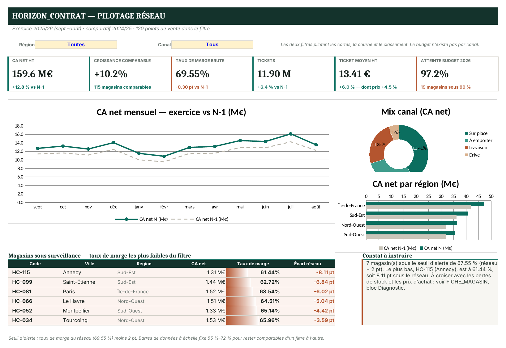
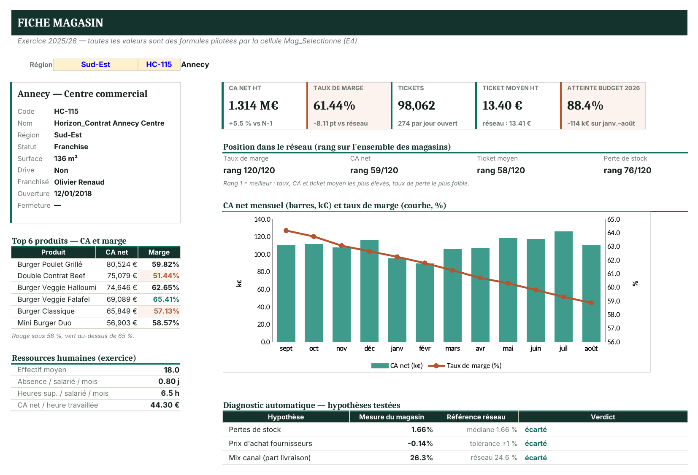
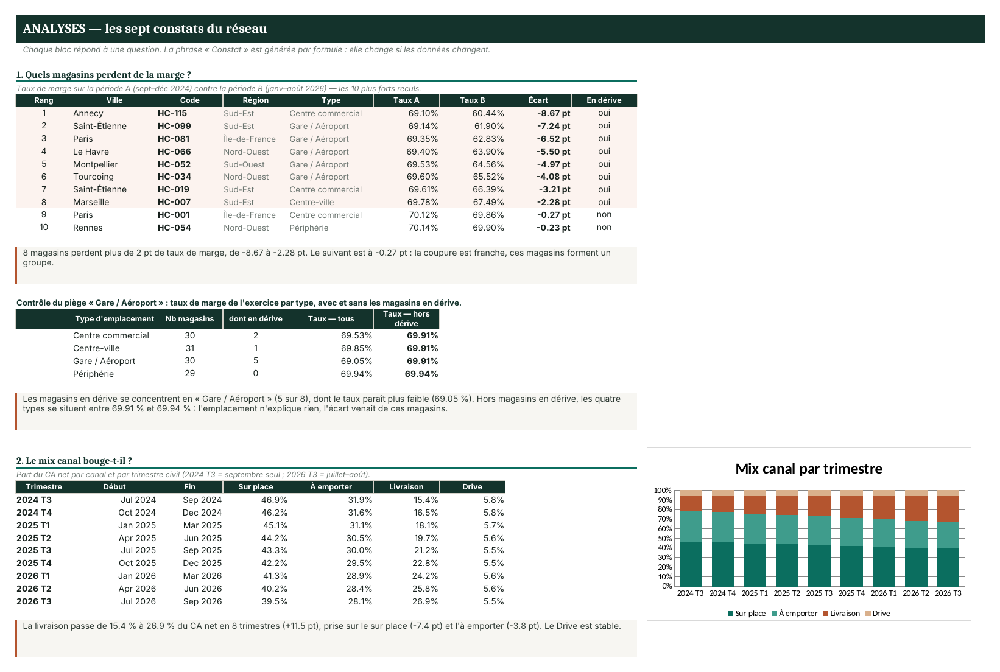
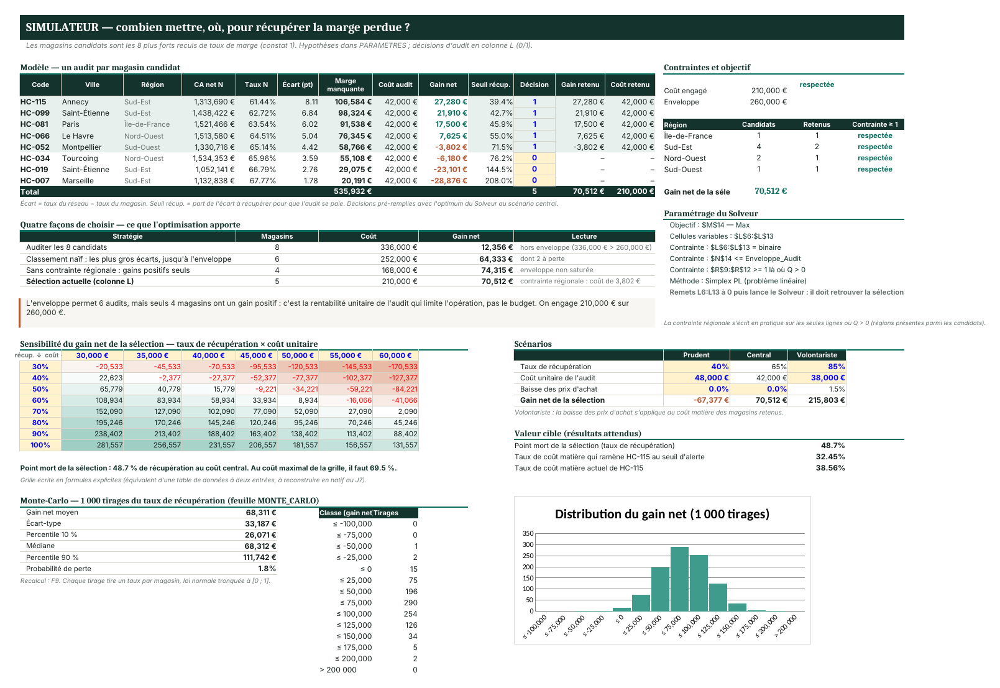

# Horizon_Contrat · pilotage d'un réseau de franchises sous Excel

**Franck Nankeng** · [LinkedIn](https://www.linkedin.com/in/franck-nankeng-51b43b297/) · *[English summary below](#english-summary)*

Suite Excel de pilotage pour un réseau fictif de **120 restaurants franchisés** répartis sur 4 régions, sur **24 mois** d'activité (septembre 2024 → août 2026). Cas d'étude sur données simulées.



## En bref

| | |
|---|---|
| Données | 669 000 lignes : ventes journalières, mix produits, stocks, achats fournisseurs, heures RH, budgets |
| Classeur | 21 feuilles, plus de 24 000 formules, aucun chiffre de restitution saisi à la main |
| Analyse | 7 constats chiffrés, rédigés par formule : ils se mettent à jour avec les données |
| Décision | Simulateur de sélection des magasins à auditer, avec scénarios, sensibilité et 1 000 tirages Monte-Carlo |
| Automatisation | Couche VBA : construction du modèle Power Query / Power Pivot, PDF par magasin, formulaire de saisie, brouillons Outlook, journal |

## Ce que contient le classeur

| Feuille | Rôle |
|---|---|
| `DASHBOARD` | Vue réseau filtrable par région et canal : KPI, CA mensuel N / N-1, mix canal, CA par région, magasins sous surveillance, commentaire généré |
| `FICHE_MAGASIN` | Fiche d'un magasin choisi dans une liste en cascade : indicateurs, rangs, courbe mensuelle, top produits, RH, diagnostic automatique. C'est aussi le modèle du PDF envoyé à chaque franchisé |
| `ANALYSES` | Les sept constats, chacun avec sa question, son tableau et sa phrase de conclusion |
| `SIMULATEUR` | Choix des magasins à auditer : modèle, contraintes, comparaison de stratégies, grille de sensibilité, scénarios, valeur cible, Solveur |
| `MONTE_CARLO` | 1 000 tirages du taux de récupération par magasin |
| `PARAMETRES` | Toutes les constantes du classeur, chacune dans une cellule nommée |
| `QUALITE` | Résultats du nettoyage des fichiers sources et contrôles recalculés en direct |
| `CALC_*`, `DATA_*`, `REF_*` | Calculs intermédiaires visibles pour être auditables, données nettoyées, référentiels |

Principe de construction : aucune valeur en dur dans une formule, tous les seuils dans `PARAMETRES`, des tableaux structurés et des noms définis partout.



## Les sept constats

1. **Dérive de marge.** 8 magasins perdent plus de 2 points de taux de marge entre fin 2024 et 2026, de −8,67 à −2,28 pt ; le suivant est à −0,27 pt. Le type d'emplacement n'explique rien : hors ces magasins, les quatre types sont entre 69,91 % et 69,94 %.
2. **Bascule vers la livraison.** Elle passe de 15,4 % à 26,9 % du CA net en 8 trimestres, au détriment du sur place et de l'à emporter.
3. **Deux fournisseurs dérivent.** Retard moyen de +3,03 et +2,91 jours, contre +0,18 jour au plus pour les autres, avec une dérive progressive.
4. **Pertes de stock anormales.** 6 magasins dépassent deux fois la médiane du réseau (1,65 %), de 3,45 % à 9,95 %. Aucun n'est en dérive de marge : les deux problèmes sont distincts.
5. **Périmètre comparable.** La croissance de 12,8 % se décompose en 10,2 % à périmètre comparable (115 magasins) et 2,6 points d'effet périmètre.
6. **Effet prix isolé.** Le ticket moyen saute de 12,73 € à 13,32 € en septembre 2025 (+4,6 %), pour une hausse tarifaire de 4,5 %.
7. **Absentéisme et heures supplémentaires.** 3 magasins cumulent un absentéisme double de la médiane et 9 à 19 heures supplémentaires par salarié et par mois.



## Simulateur d'audit

Le simulateur choisit les magasins à auditer parmi les 8 en dérive, sous une enveloppe de 260 000 € et une contrainte d'au moins un audit par région concernée. Recommandation au scénario central : auditer 5 magasins pour 210 000 €, gain net attendu de 68 000 €, compris entre 26 000 € et 112 000 € dans 80 % des tirages, avec 1,8 % de risque de perte. L'enveloppe permettrait 6 audits, mais seuls 4 magasins ont un gain positif : c'est la rentabilité de l'audit qui limite l'opération, pas le budget.



## Qualité des données

Les fichiers sources contiennent des défauts réalistes, tous traités et tracés dans la feuille `QUALITE` : formats de date et séparateurs décimaux hétérogènes, 240 doublons, 422 lignes sans code magasin, libellés de canal incohérents, taux horaires stockés en texte, budgets à dépivoter. Le détail est dans [`Donnees/LISEZ-MOI.md`](Donnees/LISEZ-MOI.md).

## Utiliser le projet

1. Télécharger le dépôt (bouton **Code › Download ZIP**) et le décompresser.
2. Ouvrir `Horizon_Contrat_Pilotage.xlsx` dans Excel 2016 ou plus récent. Le classeur se recalcule à l'ouverture.
3. Changer la région et le canal en haut du `DASHBOARD`, ou le magasin dans `FICHE_MAGASIN`.
4. Pour la couche Power Pivot et VBA : enregistrer le classeur en `.xlsm`, importer les modules du dossier [`vba/`](vba/) puis lancer `InstallerReporting` et `ConstruireModele`. Le pas-à-pas complet, avec les valeurs de contrôle attendues, est dans [`vba/LISEZ-MOI_VBA.txt`](vba/LISEZ-MOI_VBA.txt).

## Couche Power Pivot et VBA

| Module | Rôle |
|---|---|
| `modConstruireModele` | Construit le modèle depuis Excel : 19 requêtes Power Query, 11 tables, 17 relations, 31 mesures DAX, et un TCD de contrôle |
| `modReporting` | Génère une fiche PDF par magasin à partir de `FICHE_MAGASIN` |
| `modEnvoi` | Prépare un mail Outlook par franchisé avec sa fiche (brouillons par défaut) |
| `modSaisie` + formulaire | Formulaire de saisie des relevés avec six contrôles de cohérence |
| `modJournal`, `modActualisation`, `modDeploiement` | Journal des traitements, actualisation, protection des feuilles techniques |

Le code M des requêtes et les mesures DAX sont aussi lisibles en clair dans [`vba/PowerQuery_M/`](vba/PowerQuery_M/) et [`vba/Mesures_DAX.txt`](vba/Mesures_DAX.txt).

## Structure du dépôt

```
Horizon_Contrat_Pilotage.xlsx   classeur de pilotage
Donnees/                        fichiers sources (24 fichiers de ventes, référentiels, stocks, achats, RH, budgets)
docs/                           captures du classeur
vba/                            modules VBA, code du formulaire, requêtes M, mesures DAX, guide d'installation
```

## Outils

Excel avancé (tableaux structurés, noms définis, SOMME.SI.ENS, INDEX/EQUIV, SOMMEPROD, validation en cascade, mise en forme conditionnelle, graphiques), Solveur, simulation Monte-Carlo, Power Query, Power Pivot (DAX), VBA.

---

## English summary

Excel management suite for a fictional network of **120 franchised restaurants** across 4 regions, covering **24 months** (September 2024 to August 2026). Case study on simulated data.

- **Data:** 669,000 rows (daily sales, product mix, stock, supplier orders, HR hours, budgets) with realistic quality defects, all fixed and logged in the `QUALITE` sheet.
- **Workbook:** 21 sheets and over 24,000 formulas; no reported figure is typed by hand, every threshold lives in a named cell.
- **Analysis:** seven quantified findings written by formula (margin drift in 8 stores, shift to delivery from 15.4% to 26.9% of sales, two drifting suppliers, abnormal stock losses, like-for-like growth of 10.2% out of 12.8%, a 4.5% price increase isolated from volume, absenteeism covered by overtime).
- **Decision:** an audit-selection simulator with scenarios, a sensitivity grid, Solver and 1,000 Monte Carlo draws. Central recommendation: audit 5 stores for €210k, expected net gain €68k.
- **Automation:** a VBA layer that builds the Power Query / Power Pivot model, generates one PDF per store, provides a validated data-entry form and prepares Outlook drafts.
